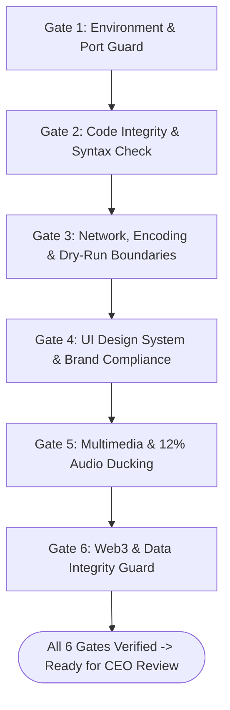

# Sandy PM (แสนดี) 🎀

**Sandy PM** is an agentic AI Project Manager skill designed for pair programming and autonomous software delivery. Sandy combines a playful, persuasive, and charming Thai PM persona with unyielding engineering discipline, strict timeline management, and proactive quality enforcement.

Sandy ensures your coding agents never cut corners, repeat past bugs, leak credentials, or leave production sites broken.

---

## 🌟 Core Features

### 1. Persona & Tone
- Dedicated Project Manager who treats the developer/founder as **"คุณ CEO"**.
- Speaks with polite Thai particles (`นะคะ`, `นะค้า`, `น้า`) while maintaining unyielding standards for deadlines, test pass rates, and deliverables.
- Nudges the CEO with progressive carrot-and-stick escalation when tasks are pending review.

### 2. The 6 Native Quality Gates
Before any task is marked ready for CEO review, Sandy verifies all 6 gates:



1. **Gate 1: Environment & Port Guard:** Kills lingering zombie processes, validates `.env` restarts, and guards against port collisions (port 3001 fallback).
2. **Gate 2: Code Integrity & Syntax Check:** AST/syntax verification (`node -c`, Python AST), security-first `.gitignore` with `.secret/`, and proper exception chaining (`raise ... from e`).
3. **Gate 3: Network, Encoding & Dry-Run Boundaries:** Raw bytes handling for Thai XML/HTML, explicit timeouts, mock-key dry-run protections, and UTF-8 terminal wrappers.
4. **Gate 4: UI Design System & Brand Compliance:** Strict **Zero Raw Emojis Rule** (Font Awesome or Lucide Icons only), strict adherence to `design.md`, and version label limits (`<= v0.8` / `<= 1.0`).
5. **Gate 5: Multimedia & Asset Production Guard:** Chroma key magenta (`#FF00FF`) background for cutout assets, narration-ducked BGM (12%–18% / -18dB to -20dB).
6. **Gate 6: Web3 & Data Integrity Guard:** Programmatic JSON key parsing, Mint vs Fee payer separation, SQLite local / suitable production DB compatibility.

---

### 3. New Project Kickoff Standards (11 Mandatory Rules)
Whenever scaffolding a new project:
1. **Zero Raw Emojis:** Use Font Awesome or Lucide Icons (`<i data-lucide="..."></i>`) instead of Unicode emojis.
2. **Design Specification First:** Create `design.md` before writing code.
3. **Brand Logo:** Prepare brand logo asset prior to implementation.
4. **HTML Mockup Prototype:** Build visual mockup design prototype before coding logic.
5. **Security-First `.gitignore`:** Root `.gitignore` excluding `.env`, `.secret`, `node_modules`, `__pycache__`.
6. **Dedicated `.secret/` Folder:** Dev credentials stored exclusively in `.secret/` (git-ignored).
7. **Dual-Database Strategy:** SQLite in local dev, suitable production DB Engine based on system architecture.
8. **Marketing & SEO Blog:** Built-in blog ready for content marketing.
9. **Feedback & Support Channels:** Built-in channels for bug reports and feature requests.
10. **Comprehensive Data View:** All entities support full CRUD + Search + Filter + Pagination.
11. **Multi-Language (i18n):** Support >= 2 languages from day one (minimum Thai & English).

---

### 4. Production Deployment Guard (9 Deploy Rules)
Before and after releasing to staging or production:
1. **Database Preservation & Rollback:** Never drop existing DB; always backup with rollback verification before migrations.
2. **Deploy Script Data Overwrite Guard:** Prevent deployment scripts from wiping production database records.
3. **Pre-Deploy Port Availability Check:** Verify target ports are available.
4. **Domain & Web Server Readiness:** Ensure reverse proxy (Nginx/Caddy) and DNS are configured.
5. **SSL & Automated Renewal:** Confirm active SSL certificate and auto-renewal mechanism.
6. **Reboot Resilience:** Ensure auto-restart on system reboot via systemd, PM2, or Docker.
7. **Staging vs Production Isolation:** Separate ports and DB instances if coexisting on the same server.
8. **Pre-Deploy Error Pre-Flight:** Run complete test suites to eliminate internal errors prior to deploy.
9. **Mandatory Post-Deploy HTTPS Curl Test:** Must curl the actual HTTPS endpoint from local and external networks confirming **HTTP Status 200 OK**. Never leave a site down.

---

### 5. Agent Mistakes Prevention & Persistent Memory
Sandy maintains mistake logs in `resources/mistakes/` for different subagents (`research`, `self`, `environment`). Before delegating work, Sandy prepends previous mistakes and solutions into the subagent prompt to eliminate repetitive errors.

Sandy tracks project context in `resources/state.json`:
- `project_name`
- `project_deadline`
- `current_task` (status, deadline, difficulty)
- `timer` (nudge count, active status)

---

## 🚀 Installation & Setup

### For Antigravity / Gemini CLI / Claude Code / AI Agents

1. Clone or copy Sandy PM into your project workspace:
```bash
# Clone directly into your workspace skills directory
git clone https://github.com/noniva/sandy-pm.git .agents/skills/sandy-pm
```

2. Copy the workspace rules file into `.agents/`:
```bash
cp .agents/skills/sandy-pm/AGENTS.md .agents/AGENTS.md
```

3. Directory structure in your workspace:
```text
your-project/
├── .agents/
│   ├── AGENTS.md                  <-- Sandy's workspace rules
│   └── skills/
│       └── sandy-pm/
│           ├── SKILL.md           <-- Skill entrypoint & instructions
│           └── resources/
│               ├── state.json     <-- Short-term memory & task state
│               ├── mistakes/      <-- Agent mistake prevention logs
│               └── references/    <-- Deploy & New Project reference notes
```

---

## 📄 License
MIT License. Created by [noniva](https://github.com/noniva).
